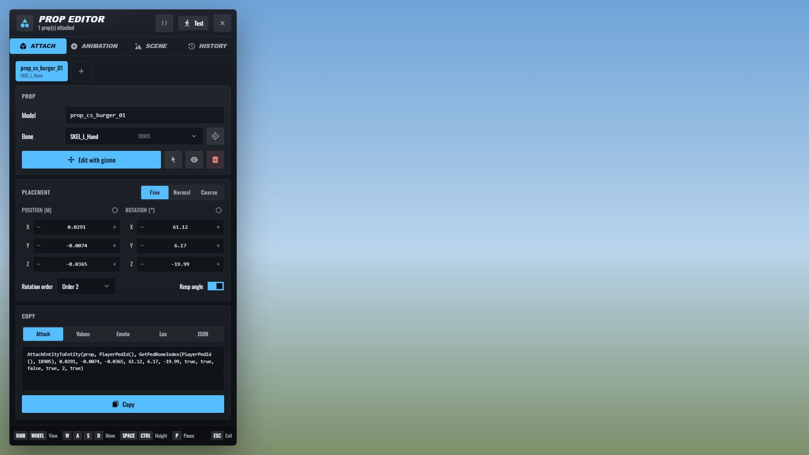
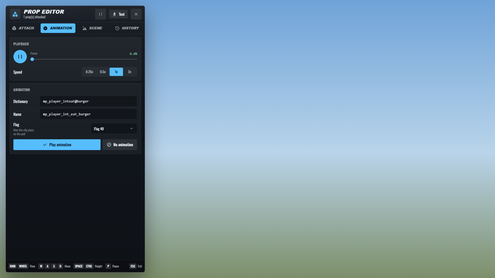
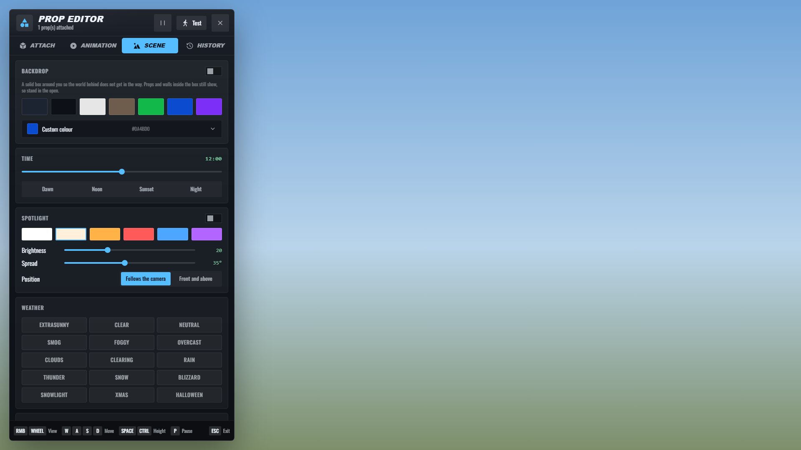
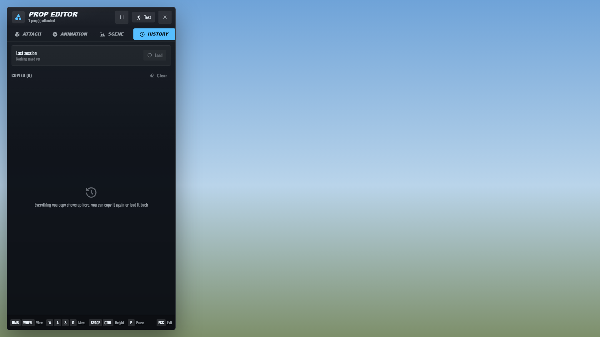

# ars_proptool

A standalone in-game **prop attach editor** for FiveM. Attach props to your ped, place them precisely with a gizmo, preview the animation, and copy the result in the format you need.

No framework, no other resource required.



| Animation | Scene | History |
| --- | --- | --- |
|  |  |  |

## Features

- Attach several props to the ped, each on its own bone (bone picker, or pick a bone on the ped).
- Precise position and rotation fields with Fine / Normal / Coarse steps, six rotation orders and a **Keep angle** option when the order changes.
- Two gizmos: a **UI gizmo** drawn in the panel's own page, and the game's **native gizmo**.
- Animation tab: dictionary, name and flag, play / pause (`P`), frame scrub and speed.
- Scene tab: solid backdrop (RGBA colour picker), time of day, weather, spotlight. Everything is local to you and put back when you leave.
- Orbit camera with mouse and keyboard: right mouse to look, `WASD` to move, `Space` / `Ctrl` for height, `Shift` for precision. Look and move speed are sliders.
- **Test mode**: go back to where you started and walk around with the props on, `Backspace` returns to the editor.
- Copy formats: Attach, Values, Emote, Lua, JSON. History keeps what you copied.
- The ped is held on an invisible platform high in the sky while the editor is open, so nothing gets in the way. Getting in and out is a plain cut, no fades or camera moves.

## Install

1. Put the `ars_proptool` folder in your `resources`.
2. Add `ensure ars_proptool` to your `server.cfg`.
3. In game, run `/proptool` (optionally `/proptool <model>` to start with a model).

The native gizmo needs no setup: it is offered when the server lets the resource run the game's gizmo commands, and the editor uses the UI gizmo when it does not. To turn the native gizmo on for a server that blocks them, grant the resource the commands (`command.+gizmoSelect`, `command.+gizmoTranslation`, `command.+gizmoRotation`, `command.+gizmoLocal` and the matching `-` versions), or `add_ace resource.ars_proptool command allow`.

Key bindings (Test mode back key and the native gizmo keys) appear in the game's key binding settings under the resource.

## Configuration

Everything is in [config/config.lua](config/config.lua): command name, default model, bone and animation, panel side, sky spot, camera speeds, default backdrop colour.

The command has no permission check. Start the resource only when you need it, or wrap the command in your own check.

## Building the UI

The compiled UI is in `web/build`. To change it (Bun):

```bash
cd web
bun install
bun run build
```

`bun run dev` serves the UI in a normal browser with a sample prop loaded, handy for design work.
Open `http://localhost:5173/?tab=scene` (tabs: `attach`, `animation`, `scene`, `history`; add `&bg=0` for a transparent page).

## Inspiration and credits

- Gizmo handling draws on ideas from [object_gizmo](https://github.com/Demigod916/object_gizmo) (GPL-3.0) by Demigod916.
- Developer-tool conventions draw on ideas from [dolu_tool](https://github.com/dolutattoo/dolu_tool) (LGPL-3.0) by dolutattoo.

Thanks to both authors.

## License

GPL-3.0, see [LICENSE](LICENSE).
